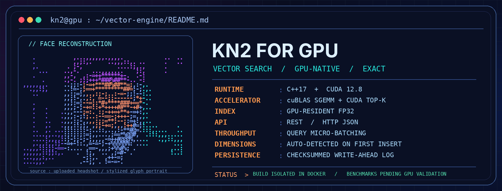
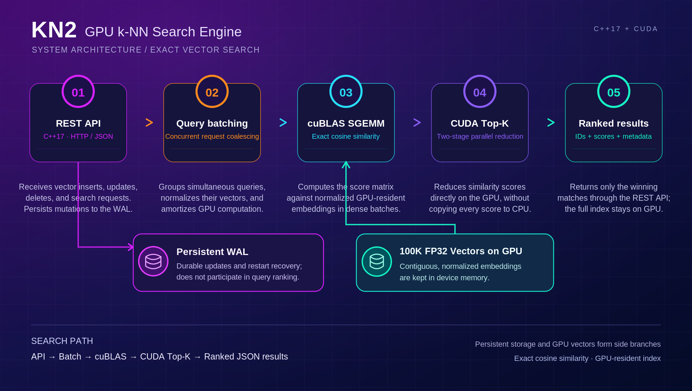

<div align="center">


# KN2 for GPU

**EXACT SEARCH &nbsp;·&nbsp; GPU-NATIVE &nbsp;·&nbsp; BUILT FOR THROUGHPUT**


<br/>



<sub>GPU-RESIDENT INDEX &nbsp; / &nbsp; CUDA TOP-K &nbsp; / &nbsp; CONCURRENT REQUEST COALESCING</sub>

</div>

### 01 / SYSTEM IDENTITY

**KN2 for GPU** is a lightweight, exact k-nearest-neighbor vector search service written entirely in C++17 and CUDA, with a REST API for insertion and retrieval. It retains normalized FP32 embeddings in GPU memory, uses cuBLAS for batched cosine-similarity scoring, and performs top-K reduction on the GPU to minimize data transfers. KN2 is designed for approximately 100,000 vectors, supports automatic embedding dimension detection on first insertion, and deploys as one NVIDIA-enabled Docker container.

> [!NOTE]
> The neon terminal portrait is a stylized rendering based on the supplied headshot. Benchmark numbers are intentionally **not** fabricated; GPU performance must be measured on actual NVIDIA hardware.

**NAVIGATION** &nbsp; [Architecture](#architecture-and-optimizations) &nbsp; · &nbsp; [Quickstart](#quickstart) &nbsp; · &nbsp; [API routes](#all-api-routes) &nbsp; · &nbsp; [Benchmark](#concurrent-search-benchmark-kn2-vs-faiss-opensearch-pgvector) &nbsp; · &nbsp; [GPU tests](#development-tests-and-validation-status)

---

## Architecture and optimizations



The horizontal search path is **REST API → query coalescing → cuBLAS SGEMM → CUDA two-stage top-K → ranked JSON results**. Persistent WAL storage branches from the API; the GPU-resident FP32 vector store supplies the cuBLAS stage. The service uses a single search worker and serialized GPU updates for consistent results; it preallocates score/working buffers, batches concurrent searches, and transfers only top-K results back to host memory.

- **Exact cosine ranking:** stored and query vectors are normalized; the FP32 dot product supplies cosine scores (subject to ordinary floating-point rounding).
- **Micro-batching:** coalesce searches for up to `KNN_BATCH_WAIT_US` (default 200 μs), with a configurable GPU query batch size.
- **Contiguous GPU vectors:** the index is uploaded once during recovery, then incremental updates upload only changed ranges.
- **Two-stage CUDA top-K:** never download the full 100K-score array per query.
- **Durability:** checksummed append-only write-ahead log (WAL), replay on restart, and partial-tail recovery. The WAL is not compacted in this release.
- **No Go, Python, FAISS, or external database in the service.** Python 3 is needed only for the optional benchmark/import/test scripts.

### Embedding dimensions: any practical size, one dimension per index

KN2 does **not** require a fixed 1024D configuration or a recompilation for 384D, 768D, 1536D, 3072D, etc. On a new index, the **first inserted vector determines `dimensions`**, which is saved in the WAL and automatically recovered after restart; all subsequent inserts and queries must use that *same* dimension (mixed dimensions cannot be compared by cosine similarity).

No artificial 4096D cap remains. Actual bounds are determined by GPU/host memory, a 16 MiB WAL record, the 64 MiB HTTP body limit, and CUDA/cuBLAS integer dimensions; for example, 100K × 1536D FP32 requires about **586 MiB** for the raw device vectors alone, plus scoring buffers and other allocations. Set `KNN_DIMENSIONS` in `.env` only if you prefer to lock the dimension *before* first insertion; leave it `0` for auto-detection. Switching a populated index to a different embedding model/dimension requires an **independent new index/volume**; it must not silently reinterpret the existing data.

## Quickstart

### Requirements

- Linux NVIDIA GPU with NVIDIA driver compatible with CUDA **12.8** and NVIDIA Container Toolkit; on Windows, Docker Desktop with WSL2 GPU passthrough.
- Docker Engine and Docker Compose v2; no host CUDA compiler, C++ toolchain, Go, or Python needed to run the server.
- Docker build image: `nvidia/cuda:12.8.1-devel-ubuntu24.04`, GCC/G++ 12 and C++17. Runtime image: `nvidia/cuda:12.8.1-runtime-ubuntu24.04`.

Check GPU availability:

```bash
docker run --rm --gpus all nvidia/cuda:12.8.1-base-ubuntu24.04 nvidia-smi
```

Start from the extracted `KN2-for-GPU` directory:

```bash
cp .env.example .env  # On PowerShell: Copy-Item .env.example .env
docker compose up --build -d
docker compose ps
curl http://127.0.0.1:8080/healthz
curl http://127.0.0.1:8080/v1/stats
```

`.env.example` uses `KNN_DIMENSIONS=0`, meaning the **first insert sets the dimension** automatically. The port is bound to `127.0.0.1:8080` by default; a named Docker volume holds `/data/index.wal` after restarts.

### Insert one vector

```bash
curl -sS -X POST http://127.0.0.1:8080/v1/vectors \
  -H 'Content-Type: application/json' \
  -d '{"id":"doc-001","vector":[1,0,0,0],"metadata":{"title":"Intro","source":"manual.pdf","page":1}}'
```

Response:

```json
{"inserted":1,"updated":0,"count":1}
```

This example **creates a 4D index**. If you instead ingest a real 768D, 1024D, or 1536D embedding first, the engine selects that size. All following curl examples use 4D vectors so they can run directly after the first insert.

### Insert a batch (up to 1,024 vectors per request)

```bash
curl -sS -X POST http://127.0.0.1:8080/v1/vectors/batch \
  -H 'Content-Type: application/json' \
  -d '{"vectors":[
    {"id":"doc-002","vector":[0.9,0.1,0,0],"metadata":{"source":"guide.pdf","page":2}},
    {"id":"doc-003","vector":[0,0,1,0],"metadata":{"source":"notes.txt"}}
  ]}'
```

Response:

```json
{"inserted":2,"updated":0,"count":3}
```

### Search — exact top-K nearest neighbors

```bash
curl -sS -X POST http://127.0.0.1:8080/v1/search \
  -H 'Content-Type: application/json' \
  -d '{"vector":[1,0,0,0],"k":2}'
```

Example response (minor FP32 rounding differences are normal):

```json
{
  "metric":"cosine",
  "k":2,
  "count":2,
  "results":[
    {"id":"doc-001","score":1.0,"metadata":{"title":"Intro","source":"manual.pdf","page":1}},
    {"id":"doc-002","score":0.9938837,"metadata":{"source":"guide.pdf","page":2}}
  ]
}
```

### Batch search — more throughput under concurrency

```bash
curl -sS -X POST http://127.0.0.1:8080/v1/search/batch \
  -H 'Content-Type: application/json' \
  -d '{"queries":[
    {"vector":[1,0,0,0],"k":2},
    {"vector":[0,0,1,0],"k":1}
  ]}'
```

Response schema:

```json
{"metric":"cosine","queries":[
  {"k":2,"count":2,"results":[{"id":"doc-001","score":1.0,"metadata":{}},{"id":"doc-002","score":0.9938837,"metadata":{}}]},
  {"k":1,"count":1,"results":[{"id":"doc-003","score":1.0,"metadata":{}}]}
]}
```

**Note:** the sample above abbreviates the metadata for `doc-001` to `{}` to show the response shape. A real response retains the metadata supplied on insertion.

### Retrieve, update, delete, and inspect

```bash
# Get by ID (stored vector is returned L2-normalized)
curl -sS http://127.0.0.1:8080/v1/vectors/doc-001

# Replace a vector by reusing the same ID
curl -sS -X POST http://127.0.0.1:8080/v1/vectors \
  -H 'Content-Type: application/json' \
  -d '{"id":"doc-001","vector":[0.8,0.2,0,0],"metadata":{"version":2}}'

# Delete by ID
curl -sS -X DELETE http://127.0.0.1:8080/v1/vectors/doc-003

# Index statistics and hardware backend
curl -sS http://127.0.0.1:8080/v1/stats

# Health check
curl -sS http://127.0.0.1:8080/healthz
```

### All API routes

| Method | Path | JSON request body / result |
|---|---|---|
| `POST` | `/v1/vectors` | `{ "id":"doc-001", "vector":[...], "metadata":{} }` — upsert |
| `POST` | `/v1/vectors/batch` | `{ "vectors":[{ "id":"...", "vector":[...] }] }` — batch upsert |
| `POST` | `/v1/search` | `{ "vector":[...], "k":10 }` — exact top-K |
| `POST` | `/v1/search/batch` | `{ "queries":[{ "vector":[...], "k":10 }] }` — batched search |
| `GET` | `/v1/vectors/{id}` | Normalized stored vector and metadata |
| `DELETE` | `/v1/vectors/{id}` | Deletes one vector |
| `GET` | `/v1/stats` | Count, capacity, dimensions, backend, WAL size |
| `GET` | `/healthz` | `{"status":"ok"}` |

IDs: 1–128 characters of ASCII letters/numbers/`. _ : -`. A vector must be non-empty, finite, non-zero and dimension-compatible. The batch insert limit is 1,024 records; the query batch limit defaults to 32 and is configurable up to 128; `k` defaults to 10 and is limited to 32. On an empty auto-dimension index, `/v1/stats` returns `dimensions: 0`, and searching before inserting returns HTTP 400.

## Concurrent-search benchmark: KN2 vs. FAISS, OpenSearch, pgvector

**Benchmark status: results not yet measured.** No CUDA GPU or comparable FAISS/OpenSearch/PostgreSQL hosts are available in the build environment. It would be misleading to insert estimated or invented p95 latency/QPS numbers, or to compare KN2 exact search against approximate HNSW indexes without recording recall. Use the following table as the reproducible benchmark report; fill it from the benchmark outputs **on the same hardware and dataset**.

| Concurrent clients | KN2 CUDA: QPS / p95 | FAISS GPU FlatIP: QPS / p95 | OpenSearch k-NN: QPS / p95 | pgvector: QPS / p95 |
|---:|---|---|---|---|
| 1 | Not measured | Not measured | Not measured | Not measured |
| 8 | Not measured | Not measured | Not measured | Not measured |
| 16 | Not measured | Not measured | Not measured | Not measured |
| 32 | Not measured | Not measured | Not measured | Not measured |

**Benchmark contract:** 100,000 vectors × 1,024 dimensions, FP32, identical L2-normalized dataset and query corpus, cosine similarity, top-10, warm indexes, 1,000+ requests per concurrency setting, same GPU/CPU resources, and server + client pinned versions. Report *both* QPS and p50/p95/p99 HTTP end-to-end latency for each engine at 1/8/16/32 concurrent calls, plus GPU utilization and memory, ingestion time, and recall@10. Match exact-search algorithms when possible: KN2 exhaustive cosine, FAISS GPU `GpuIndexFlatIP`, and an exact pgvector scan (or label HNSW results as approximate with recall); OpenSearch k-NN defaults to ANN methods and its recall must be measured separately.

The included **KN2 REST benchmark script** performs warmup and reports throughput plus latency percentiles:

```bash
python3 scripts/benchmark.py --dimensions 1024 --requests 2000 --workers 1
python3 scripts/benchmark.py --dimensions 1024 --requests 2000 --workers 8
python3 scripts/benchmark.py --dimensions 1024 --requests 2000 --workers 16
python3 scripts/benchmark.py --dimensions 1024 --requests 2000 --workers 32
```

Load the 100K embedding index before running these commands; otherwise the numbers reflect an empty or small index. Other engines require their own equivalent HTTP adapters or a standardized benchmark harness to avoid mixing local FAISS function-call timings with networked REST timings. Relevant starting points are the [FAISS GPU index guide](https://github.com/facebookresearch/faiss/wiki/Faiss-on-the-GPU) and [OpenSearch official benchmarks](https://opensearch.org/benchmarks/); neither is a KN2 head-to-head result.

## Bulk load 100K vectors

Input JSONL (one vector per line; all arrays have the same dimension):

```jsonl
{"id":"pdf:1:chunk-01","vector":[1,0,0,0],"metadata":{"source":"guide.pdf","page":1}}
{"id":"pdf:1:chunk-02","vector":[0,0.5,0.5,0],"metadata":{"source":"guide.pdf","page":1}}
```

```bash
python3 scripts/ingest.py ./embeddings.jsonl --batch 512
```

The example JSONL is 4D for readability; your real embedding arrays can be 384D, 768D, 1024D, 1536D, etc. The first inserted vector sets the dimension unless `KNN_DIMENSIONS` was explicitly set. Ingestion performs normalization automatically.

## Environment configuration

| Variable | Default | Meaning |
|---|---:|---|
| `KNN_DIMENSIONS` | `0` | Auto-learn on first insert; set positive integer to pin upfront |
| `KNN_CAPACITY` | `100000` | Maximum live vectors (WAL tracks this) |
| `KNN_MAX_BATCH` | `32` | Maximum coalesced GPU queries (1–128) |
| `KNN_MAX_K` | `32` | Maximum neighbors per query (1–32) |
| `KNN_BATCH_WAIT_US` | `200` | Query coalescing window; `0` favors latency |
| `KNN_HTTP_THREADS` | `16` | HTTP worker pool |
| `KNN_HOST_PORT` | `8080` | Host port, published on loopback only |
| `CUDA_ARCHS` | `75-real;80-real;86-real;89-real;90-real;120-real;89-virtual` | Compiled GPU targets |

Change dimensions by creating **another index volume** rather than reusing an existing WAL; do not use `docker compose down -v` on data you need to keep. For RTX 4090 you may select `CUDA_ARCHS=89-real;89-virtual`, for RTX 3090 `86-real;86-virtual`, or for RTX 5090 `120-real;120-virtual` (verify toolkit/driver support).

**Security:** the service is intentionally localhost-only, with no built-in authentication, TLS, quotas, or tenant isolation. Put an authenticated reverse proxy in front of it before allowing remote clients. Persisted WAL batches are durable but not all-or-nothing transactions; automatic WAL compaction and index sharding are not implemented.

## Development, tests, and validation status

- **Verified here:** C++17 reference-backend compilation; REST insertion/search/validation; first-insert dimension inference; search rejection before initial insert; dimension mismatch rejection; WAL recovery after restart; API concurrency; and a 1,024-vector CPU top-K oracle test.
- **Not verified here:** CUDA compilation, execution of CUDA kernels, GPU correctness across devices, and actual hardware p95/QPS. The production Docker image **does not** fall back silently to CPU.

To run the CPU reference implementation for development (not for GPU performance results):

```bash
sudo apt-get install cmake g++ libboost-dev libjson-c-dev
cmake -S . -B build -DKNN_CPU_ONLY=ON -DCMAKE_BUILD_TYPE=Release
cmake --build build -j
KNN_DIMENSIONS=0 KNN_CAPACITY=1200 KNN_PORT=18089 KNN_WAL_PATH=/tmp/kn2-reference.wal ./build/knn_server
# In another terminal, after inserting test vectors:
KNN_URL=http://127.0.0.1:18089 python3 scripts/test_api.py
# Separate process: fresh index and isolated temporary WAL
python3 scripts/test_auto_dimensions.py --server ./build/knn_server
```

On the actual NVIDIA host, run GPU correctness tests from a fresh index and execute the benchmark after ingestion:

```bash
python3 scripts/test_gpu_correctness.py --dimensions 1024 --count 1024 --k 20
python3 scripts/benchmark.py --dimensions 1024 --requests 2000 --workers 16
```

`openapi.yaml` is the API contract. Source code is in `src/`, backend interface in `include/`, and scripts in `scripts/`.
